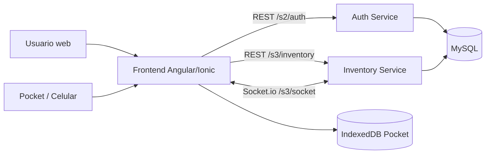
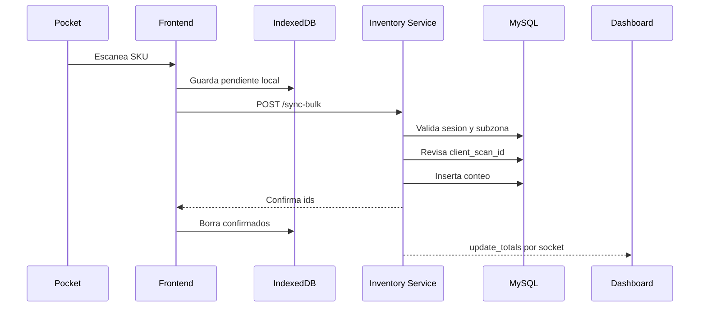
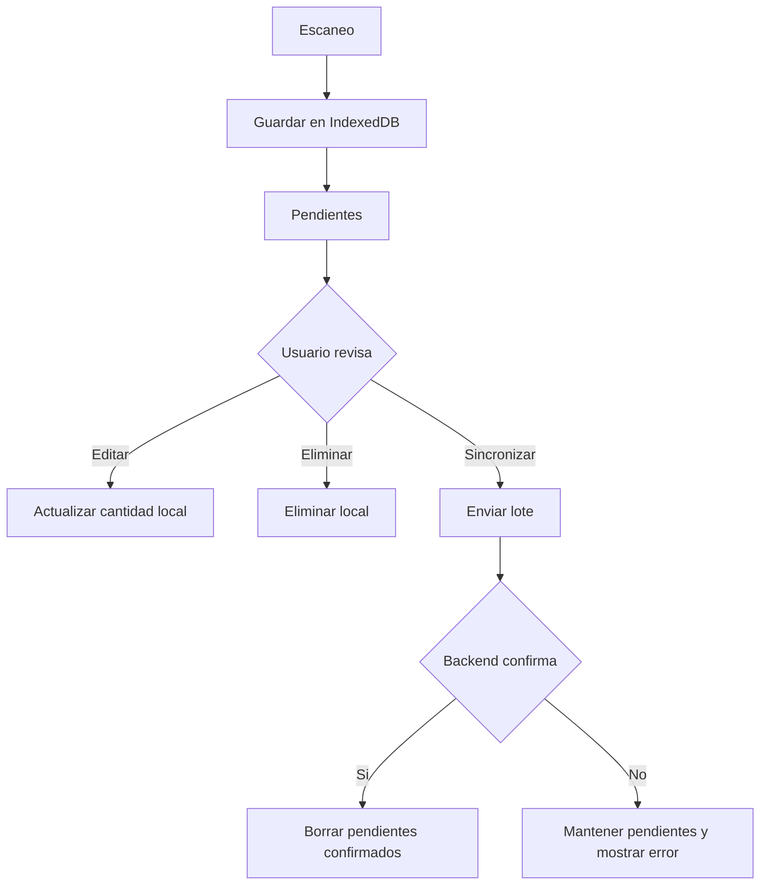
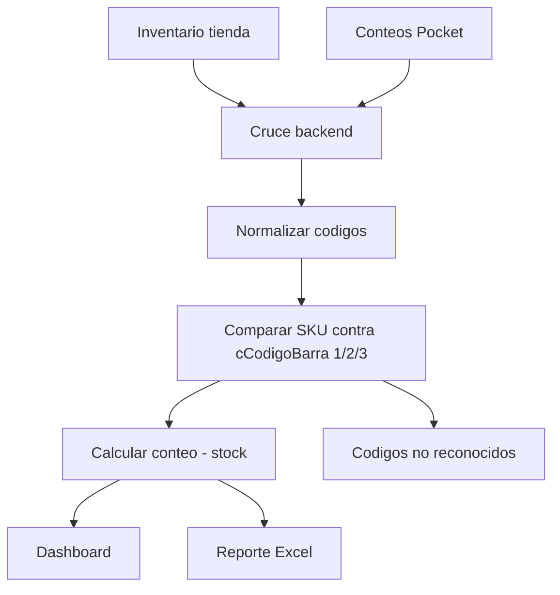
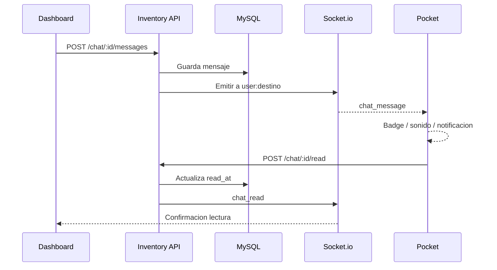
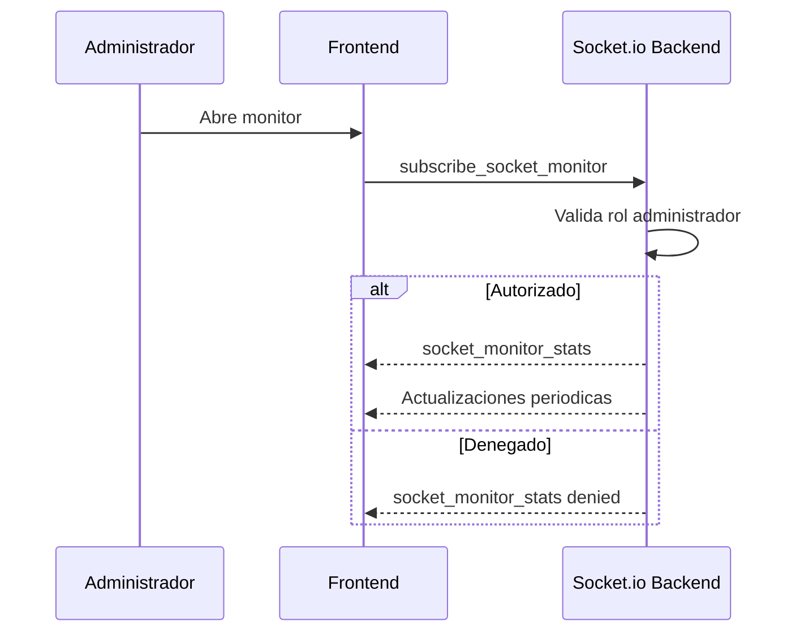
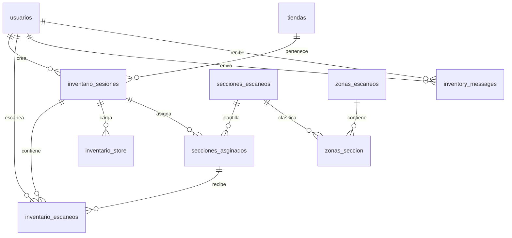
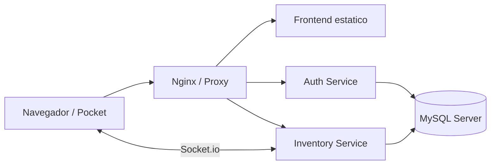

# Diagramas del sistema

Los diagramas usan Mermaid.

## 1. Arquitectura general

## 2. Casos de uso

```mermaid
flowchart TB
    Admin[Administrador]
    Auditor[Auditor]
    Pocket[Usuario Pocket]

    Admin --> UC1[Crear sesion]
    Admin --> UC2[Configurar zonas/subzonas]
    Admin --> UC3[Importar inventario]
    Admin --> UC4[Monitorear dashboard]
    Admin --> UC5[Exportar reportes]
    Admin --> UC6[Ver rendimiento]
    Admin --> UC7[Monitor de sockets]
    Admin --> UC8[Chat]

    Auditor --> UC4
    Auditor --> UC5
    Auditor --> UC6
    Auditor --> UC8

    Pocket --> UC9[Ingresar codigo de sesion]
    Pocket --> UC10[Seleccionar subzona]
    Pocket --> UC11[Escanear productos]
    Pocket --> UC12[Revisar pendientes]
    Pocket --> UC13[Sincronizar]
    Pocket --> UC14[Responder chat]
```

## 3. Flujo de escaneo online

## 4. Flujo de escaneo manual

## 5. Cruce de inventario

## 6. Chat por socket

## 7. Monitor de sockets

## 8. Base de datos

## 9. Despliegue

