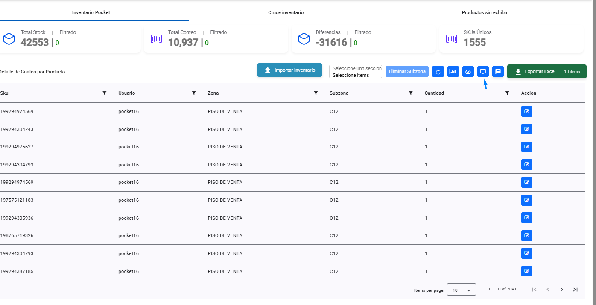
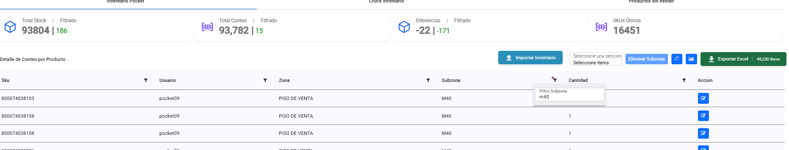
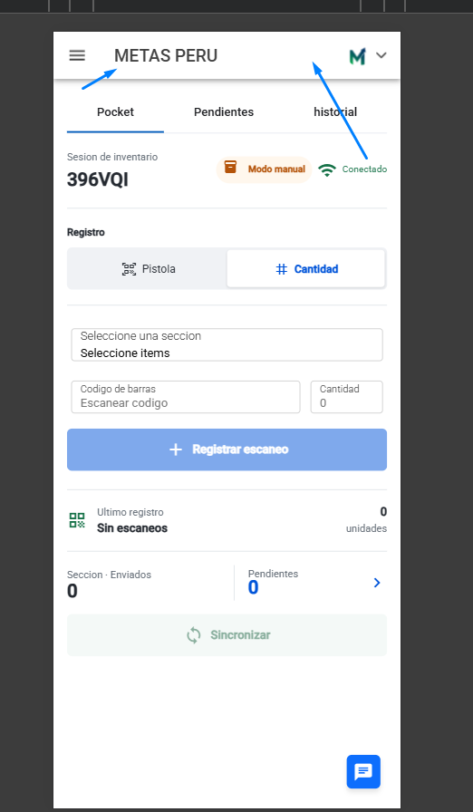
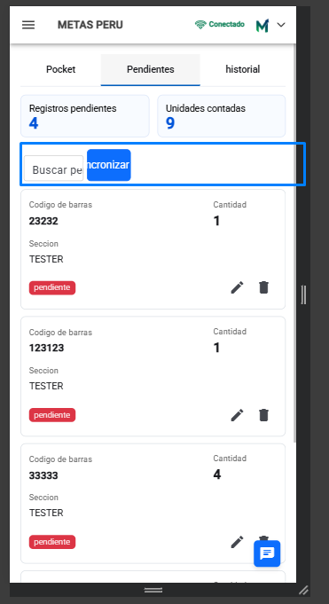
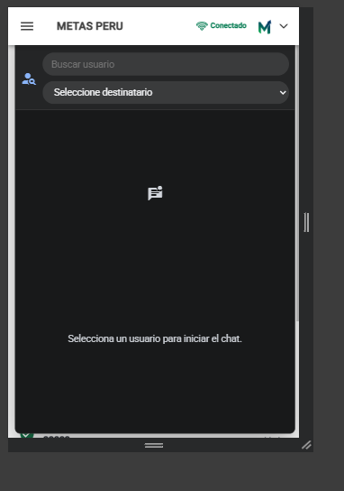
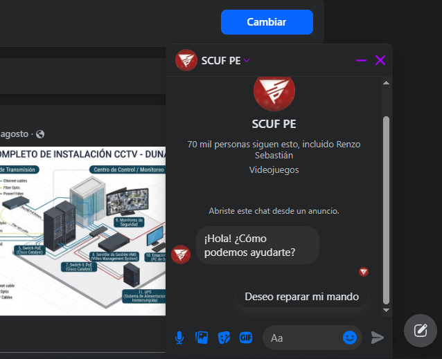
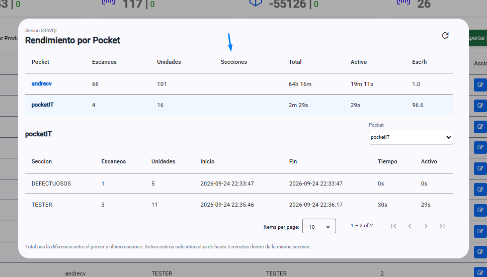
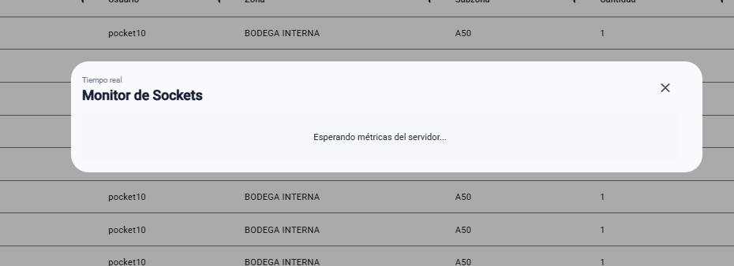

# Pantallazos del sistema

Este documento contiene capturas de referencia de las pantallas principales del sistema de inventario. Sirve para manual de usuario, capacitacion, soporte y validacion visual despues de cambios.

## 1. Dashboard de inventario

Vista principal del dashboard, con cards de totales, acciones de inventario, paginacion y botones de herramientas.

Elementos importantes:

- Cards de `Total Stock`, `Total Conteo`, `Diferencias` y `SKUs Unicos`.
- Boton de importar inventario.
- Selector de seccion/subzona.
- Botones de estadisticas, rendimiento, monitor y chat.
- Exportacion a Excel.
- Tabla paginada con filtros por columna.

## 2. Filtros y totales filtrados

Ejemplo de filtros aplicados en la tabla y valores filtrados en las cards.

Regla funcional:

- El total principal debe mantenerse global.
- El valor `Filtrado` cambia segun el filtro activo.
- Los filtros de subzona deben respetar coincidencia exacta cuando corresponde.

## 3. Pocket principal

Pantalla principal del modulo Pocket en vista mobile.

Elementos importantes:

- Sesion activa.
- Estado de conexion.
- Modo online/manual.
- Selector de tipo de registro: pistola o cantidad.
- Selector de subzona.
- Campo de codigo de barras.
- Boton de registrar escaneo.
- Ultimo registro.
- Resumen de enviados, pendientes y unidades contadas.
- Boton flotante de chat.

## 4. Pendientes Pocket

Vista de registros pendientes antes de sincronizar.

Elementos importantes:

- Cantidad de registros pendientes.
- Unidades contadas en memoria.
- Buscador.
- Boton sincronizar.
- Cards de pendientes con codigo, cantidad, seccion y estado.
- Acciones de editar y eliminar.

## 5. Chat mobile

Vista mobile del chat dentro del sistema.

Elementos importantes:

- Buscador o selector de usuario.
- Destinatario seleccionado.
- Area de mensajes.
- Boton flotante de chat.
- Adaptacion a pantallas pequenas.

## 6. Referencia visual de chat tipo Facebook

Referencia de estilo solicitada para el chat flotante.

Objetivo visual:

- Chat flotante.
- Cabecera compacta.
- Botones de minimizar y cerrar.
- Conversacion visible sin ocupar toda la pantalla.
- Entrada de texto siempre disponible.

## 7. Rendimiento por Pocket

Reporte de rendimiento por usuario Pocket.

Elementos importantes:

- Usuario Pocket.
- Escaneos.
- Unidades.
- Subzonas trabajadas.
- Tiempo total.
- Tiempo activo.
- Escaneos por hora.
- Detalle por zona y subzona.

## 8. Monitor de sockets

Pantalla de monitoreo de sockets para administradores.

Elementos importantes:

- Acceso solo para administrador.
- Estado de metricas del servidor.
- Eventos de socket.
- Validacion de permisos.
- Diagnostico de comunicacion en tiempo real.

## 9. Uso recomendado de pantallazos

Usar estas capturas para:

- Capacitacion de usuarios.
- Manuales impresos o PDF.
- Comparar cambios visuales despues de despliegues.
- Explicar incidencias a soporte.
- Validar que el sistema se vea correctamente en escritorio y mobile.

## 10. Mantenimiento

Actualizar las capturas cuando:

- Cambie el diseno del Pocket.
- Cambie la botonera del dashboard.
- Se agregue una nueva accion importante.
- Cambie el flujo de chat.
- Cambien los reportes o filtros.
- Se modifique la vista mobile.
